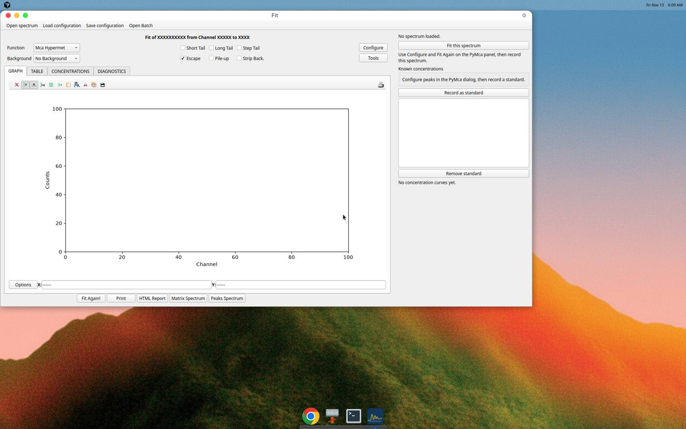

# xrfdesk

A desktop program for energy-dispersive X-ray fluorescence. [PyMca5](https://github.com/vasole/pymca) (MIT) does the fitting. This program does not reimplement the peak model.

Fit is one spectrum at a time. Batch is a separate window that runs one PyMca `.cfg` over its own file list. The program runs offline.



## Requirements

Python 3.12. The pinned PyMca5 build in `requirements.txt` is the Python 3.12 wheel.

`fisx`, which PyMca uses, needs a C compiler and Python headers the first time it is installed (`python3-dev` and `g++` on Debian or Ubuntu).

## Run from source

```bash
python3 -m venv .venv
source .venv/bin/activate
pip install -r requirements.txt
python -m xrfdesk
```

On Windows, activate the virtual environment with `.venv\Scripts\activate`.

That opens the Fit window. Batch is a second window, opened from Fit or from the bronze example inside Batch.

## Standalone program

```bash
./build.sh
```

That is `python3 build.py`. It runs PyInstaller for the machine you are on and installs an icon. The built folder is `dist/xrfdesk/`. It is not committed. Copy that whole folder to another machine; that machine does not need Python installed.

Click the **xrfdesk** icon. The Fit window opens on its own. The desktop entry has `Terminal=false`, and on Windows the program is built without a console. Double-click `dist\xrfdesk\xrfdesk.exe` there. If a file manager opens a terminal just to start the program, that terminal closes and the Fit window stays. Passing `--cfg` from a terminal you opened yourself still prints the batch log in that terminal.

## Spectrum files

- `.csv` and `.txt`: one column of counts, or `channel, counts`, or `energy, counts`
- Amptek `.mca` text (`<<DATA>>`, optional `<<CALIBRATION>>`)
- IAEA `.spe` text (`$DATA`, optional `$ENER_FIT`)

A calibration stored in the file is applied on top of the `.cfg`. The bronze files have no calibration of their own; `bronze.cfg` supplies zero and gain.

## Fit window

PyMca's advanced-fit panel is embedded here. Use its **Configure** button for the energy calibration, the elements and lines, and the fit parameters, and **Fit Again!** to draw the fit.

**Record as standard** stores the peak areas of the spectrum you are viewing together with the concentrations you type. One standard is forced through the origin. Two or more produce a slope, an intercept, and an R². **Save configuration** writes a normal PyMca `.cfg`, plus a `curves` section. PyMca ignores that section, so the file still opens there. A `.cfg` saved by PyMca opens here; it simply has no curves until you record standards.

**Open Batch** shows the Batch window with that configuration. The Batch file list starts empty.

## Batch window

Add, remove, and reorder files. The list is not the Fit window's spectrum. Load a `.cfg`, or press **Bronze example** to load `examples/bronze/bronze.cfg` and its three scans without using Fit.

**Start** fits the list in parallel. The worker count defaults to one less than the number of CPU cores. Each row is waiting, running, done, or failed with the error text. **Cancel** stops the run. A file that fails does not stop the others. The results stay in the original list order.

Concentrations use the curves stored in the configuration. The standards do not have to be in the list.

**Export CSV** asks where to save. **Fill Excel template** asks for a workbook and where to write the copy.

### Excel layout

Sheet `XRF`. Row 1 is the header. The first scan is row 2, one row per scan.

| Cell | Contents |
| --- | --- |
| A1 | `Sample` |
| B1, C1, … | Element symbols, in the order of the curves in the `.cfg` |
| A2 | First file name |
| B2 | That file's concentration for the first element |

For the bronze configuration the curve order is Fe, Cu, Zn, so B is Fe, C is Cu, D is Zn, and the first iron concentration is B2. Other sheets, formulas, and cells outside these columns are left as they are.

## Command line

```bash
python -m xrfdesk --cfg config.cfg --out results.csv --workers 4 scan1.csv scan2.csv
```

The same flags work on the built program:

```bash
./dist/xrfdesk/xrfdesk --cfg config.cfg --out results.csv --workers 4 scan1.csv scan2.csv
```

`--bronze` uses the included example:

```bash
python -m xrfdesk --bronze --out bronze.csv --workers 2
```

`--excel template.xlsx --excel-out filled.xlsx` fills the template described above.

## Tests

```bash
python -m pytest
```

The bronze batch matches fitting those three scans one at a time in the Fit window, and a two-worker run matches a one-worker run. A second set of 15 simulated spectra, each from 10,000 to 15,000 channels, does the same. Their concentrations stay within 2% of the values used to generate them.

## Limits

Quantification here is the empirical curve stored in the `.cfg`, not PyMca's fundamental-parameter concentrations. The interactive fit, the peak model, and the `.cfg` contents that PyMca itself understands are PyMca's.

## License

xrfdesk is released under the [MIT License](LICENSE). PyMca5 is MIT, copyright the European Synchrotron Radiation Facility. fisx, which PyMca uses for X-ray cross sections, is MIT as well.
